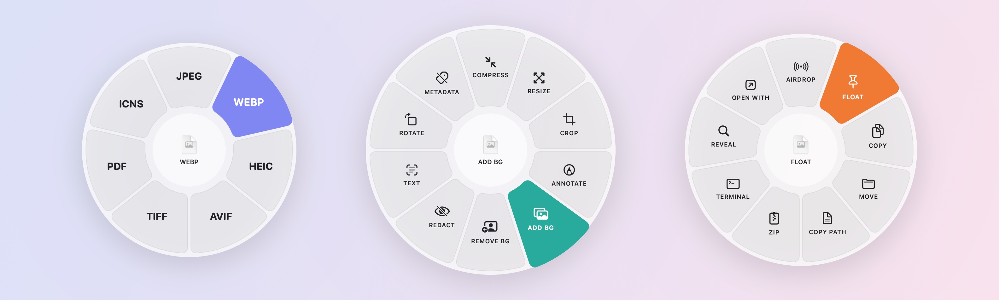

<p align="center">
  
</p>

<h1 align="center">Drovia</h1>

<p align="center"><b>Your files. One gesture away.</b><br>File utilities for macOS, right where you drag.</p>

<p align="center">
  
</p>

Drag any file, hold a modifier key, and drop it onto a wheel. Convert an image to WebP, compress a video, cut out a background, AirDrop a PDF — without opening another app.

| Hold | Wheel | For example |
| --- | --- | --- |
| ⇧ Shift | **Convert** | PNG, JPEG, WebP, HEIC, AVIF, TIFF, PDF, ICNS · DOCX/RTF/HTML → PDF · MP4, MOV, GIF · M4A, WAV, AIFF |
| ⌘ Command | **Tools** | Compress, Resize, Crop, Annotate, Add Background, Remove Background, Redact, Text (OCR), Rotate, Metadata, Merge/Split PDF, Mute video, Checksum |
| ⌃ Control | **Actions** | AirDrop, Float on a shelf, Copy, Move, Copy Path, Zip/Unzip, Terminal, Reveal, Open With |
| ⌥ Option | **Recipes** | Your own chains, e.g. *Resize → WebP → Remove metadata* |

A wheel only shows what fits the files you're dragging, and a quick flick toward a sector is enough to pick it.

## Features

- **Smart wheels.** Sectors adapt to file types; reorder or hide them in Settings. Works from Finder, the desktop, Safari, Mail and anything else you can drag files from.
- **Image editor.** Crop with aspect ratios, annotate (arrows, shapes, highlighter, pen, text, manual redaction), and frame screenshots with gradients, padding, rounded corners and shadow — one image or a whole batch.
- **On-device intelligence.** Remove backgrounds, recognize text in images and scanned PDFs, and automatically redact faces, emails, phone numbers, card numbers and QR codes. Powered by Vision; nothing leaves your Mac.
- **Floating shelf.** Park files on a shelf pinned to the screen edge and drag them out later — one at a time or all at once.
- **Recipes.** Chain any actions, Shortcuts and shell scripts, and run them from the ⌥ wheel.
- **Shortcuts.** *Process Files with Drovia* and *Run Drovia Recipe* actions return the new files to your shortcuts.
- **Keyboard mode.** Select files in Finder and press ⌃⌥D: the wheel opens at the pointer; Tab switches wheels, arrows and number keys choose.
- **Safe by default.** Originals are never overwritten, results never clobber existing files, and every change can be undone from the toast or the menu bar.
- **Private.** No network access, no accounts, no analytics. Drovia only touches files in folders you allow.

<p align="center">
  
</p>

## Requirements

- macOS 26 or later

## Building from source

You'll need Xcode 26 or later, [XcodeGen](https://github.com/yonaskolb/XcodeGen) and [SwiftFormat](https://github.com/nicklockwood/SwiftFormat):

```sh
brew install xcodegen swiftformat
git clone https://github.com/Arvesso/drovia.git
cd drovia
make run
```

`make run` generates the Xcode project from `project.yml`, builds a Debug app and launches it. Other targets:

| Command | What it does |
| --- | --- |
| `make gen` | Generate `Drovia.xcodeproj` (open it to work in Xcode) |
| `make release` | Build a Release app into `build/Build/Products/Release` |
| `make test` | Run the unit tests |
| `make format` / `make lint` | Format code / check formatting |
| `make logs` | Stream Drovia's log |
| `make signing` | Sign with your Apple Development certificate (see below) |

### Signing

Builds are ad-hoc signed by default, so anyone can build. With an ad-hoc signature macOS treats every build as a new app and asks for folder permissions again. To keep permissions between builds, add your Apple ID in Xcode → Settings → Accounts (a free account is enough), create an *Apple Development* certificate, and run `make signing`. It writes your team to `Config/Local.xcconfig`, which isn't committed.

## Permissions

| Permission | Why | When |
| --- | --- | --- |
| Files and Folders (Desktop, Documents, Downloads…) | To read and write the files you drop | Once, when you add a folder in Settings → Folders |
| Automation → Finder | To read Finder's selection for the keyboard shortcut | The first time you use it |
| Full Disk Access | Optional: one switch instead of per-folder prompts, also covers external drives | Only if you turn it on |

Drovia notices file drags by watching mouse events and the drag pasteboard, which needs no Accessibility or Input Monitoring permission.

## Contributing

Issues and pull requests are welcome — see [CONTRIBUTING.md](CONTRIBUTING.md).

## License

[MIT](LICENSE)
